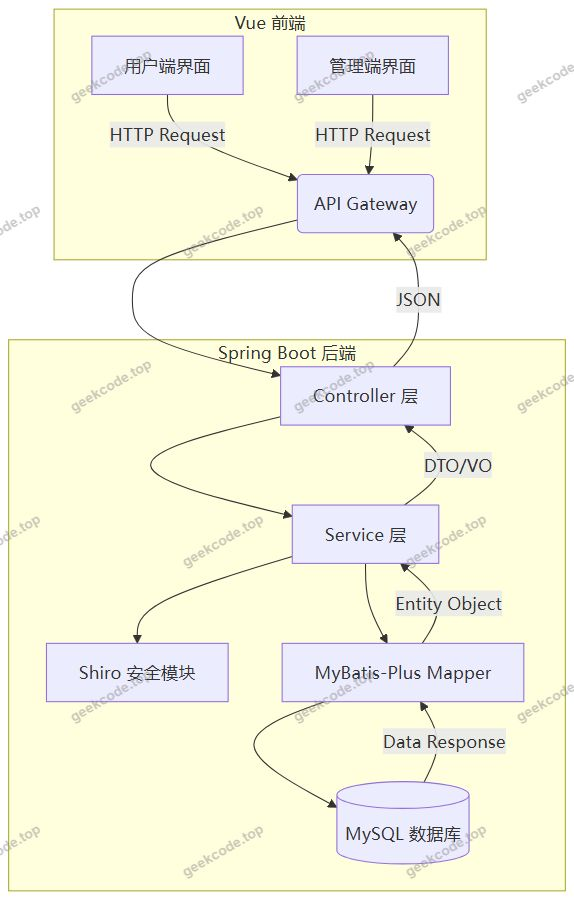
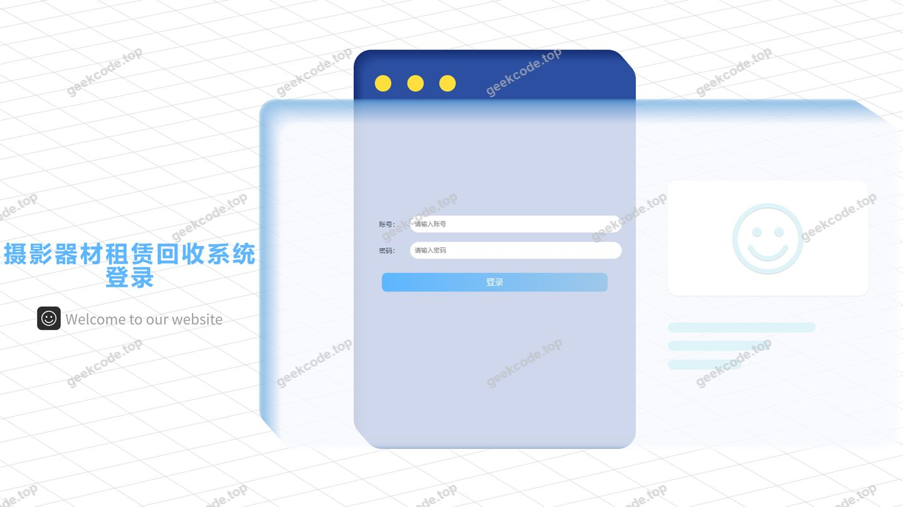
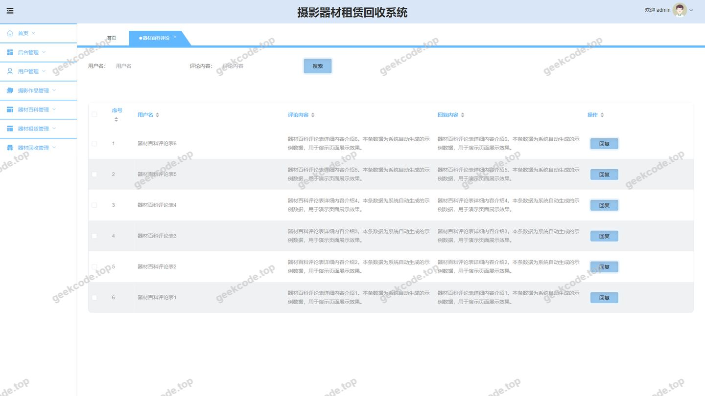
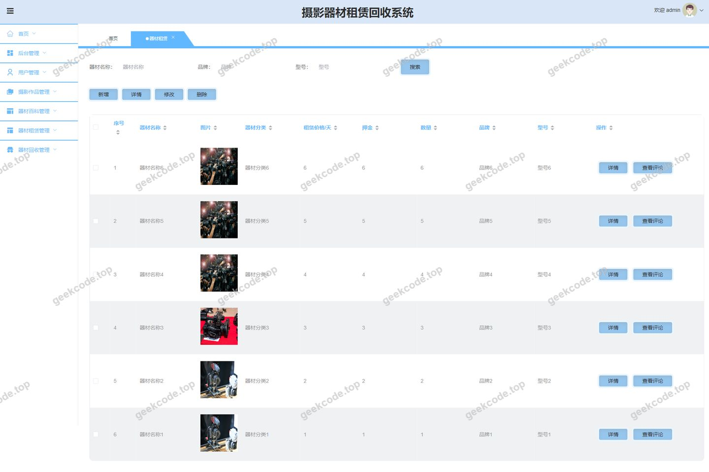
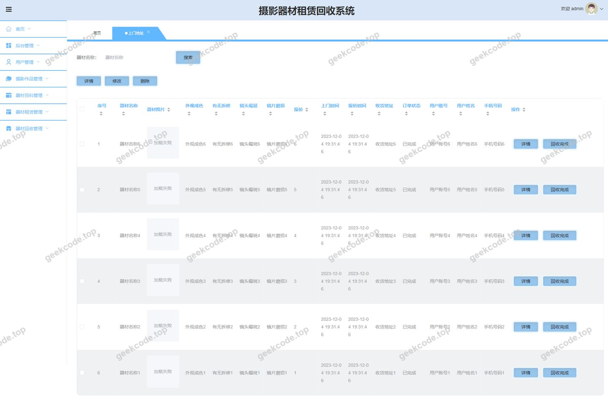
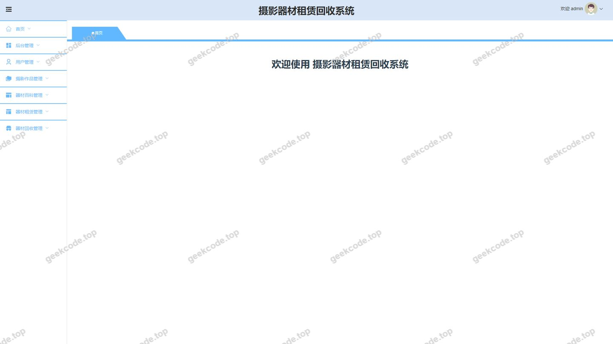
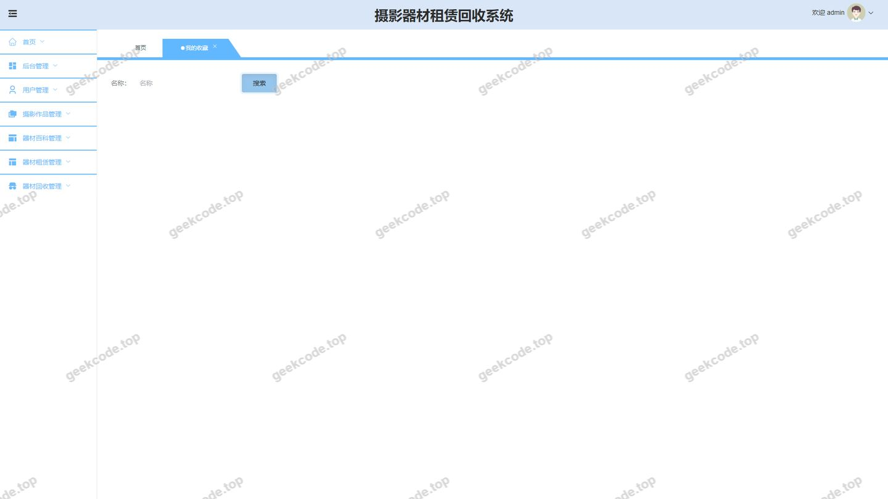
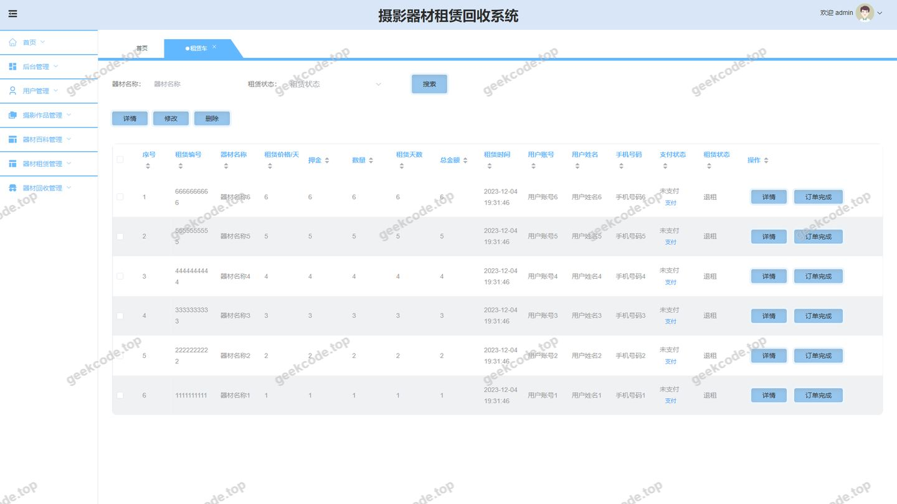

# 基于springboot + vue的摄影器材租赁回收系统

> 🎓 **计算机毕业设计 · 基于springboot + vue的摄影器材租赁回收系统**
>
> 本仓库只放**项目介绍 + 运行截图**（截图是站点带水印的原图，存在仓库 `images/` 里）。
>
> 👉 **完整可运行源码 / 数据库脚本 / 部署文档：[点我获取](https://geekcode.top/archives/%E5%9F%BA%E4%BA%8Espringboot-vue%E7%9A%84%E6%91%84%E5%BD%B1%E5%99%A8%E6%9D%90%E7%A7%9F%E8%B5%81%E5%9B%9E%E6%94%B6%E7%B3%BB%E7%BB%9F?utm_source=github)**
>
> 💬 咨询微信：**ir9372**　|　🌐 更多项目：[极客代码 geekcode.top](https://geekcode.top/?utm_source=github)
>
> 📌 项目详情页：<https://geekcode.top/archives/%E5%9F%BA%E4%BA%8Espringboot-vue%E7%9A%84%E6%91%84%E5%BD%B1%E5%99%A8%E6%9D%90%E7%A7%9F%E8%B5%81%E5%9B%9E%E6%94%B6%E7%B3%BB%E7%BB%9F?utm_source=github>

<table><td width="230" align="center"> <b>扫码加微信 ir9372</b></td><td valign="middle">📦 源码 = 项目介绍 + 全部运行截图 + 数据库 + 部署文档 👉 点上方任意截图，直接跳到 <b>极客代码 geekcode.top</b> 详情页</td></table>

---

<h1>基于springboot + vue的摄影器材租赁回收系统</h1>
<h2>项目概述</h2>

本项目旨在构建一个基于 Spring Boot 和 Vue 的摄影器材租赁与回收综合服务平台。系统核心业务涵盖摄影器材的分类展示、在线租赁、订单管理、上门回收报价及用户互动评论等功能。适用于摄影爱好者、专业摄影师以及二手器材交易商家，解决传统线下租赁信息不对称、流程繁琐及闲置器材变现难的问题。技术架构采用前后端分离模式，后端基于 Spring Boot 结合 MyBatis-Plus 实现高效数据持久化，使用 Shiro 进行权限控制；前端采用 Vue 框架提升用户体验。系统分为前台用户交互界面与后台管理界面，实现了从器材浏览、租赁下单到回收处理的全链路数字化管理。

<h2>技术架构</h2>

本系统采用经典的前后端分离架构设计，确保了系统的可维护性、扩展性及高性能。

<strong>1. 后端架构</strong>

<ul>
<li><strong>核心框架</strong>：基于 <code>spring-boot-starter-web</code> 构建 RESTful API 服务，提供轻量级且强大的 Web 开发能力。</li>
<li><strong>持久层</strong>：采用 <code>MyBatis-Plus</code> (<code>mybatis-plus</code>, <code>mybatisplus-spring-boot-starter</code>) 作为 ORM 框架，简化 CRUD 操作并支持复杂查询；底层数据库连接使用 <code>mysql-connector-java</code>，通过 <code>spring-boot-starter-jdbc</code> 管理事务。</li>
<li><strong>安全认证</strong>：集成 <code>shiro-spring</code> 实现身份认证与授权机制，保障接口访问的安全性。</li>
<li><strong>工具类库</strong>：引入 <code>commons-lang3</code> 处理通用逻辑，<code>validation-api</code> 用于参数校验，<code>protobuf-java</code> 用于特定场景下的数据序列化优化。</li>
</ul>

<strong>2. 前端架构</strong>

<ul>
<li><strong>视图层</strong>：采用 Vue.js 框架构建单页应用（SPA），通过路由配置 <code>/index/...</code> 系列路径实现页面跳转与组件渲染。</li>
<li><strong>交互逻辑</strong>：前端通过 Axios 等 HTTP 客户端调用后端提供的 JSON 格式接口，实现数据的动态加载与提交。</li>
</ul>

<strong>3. 数据库设计要点</strong>

<ul>
<li>数据库主要实体包括：用户表 (<code>yonghu</code>)、管理员表 (<code>users</code>)、器材分类 (<code>qicaifenlei</code>)、器材百科 (<code>qicaibaike</code>)、租赁车/购物车 (<code>zulinche</code>)、器材租赁记录 (<code>qicaizulin</code>)、订单完成状态 (<code>dingdanwancheng</code>)、租赁续租 (<code>zulinxuzu</code>)、损坏退回 (<code>sunhuaituihui</code>)、回收报价 (<code>huishoubaojia</code>)、回收完成 (<code>huishouwancheng</code>)、上门地址 (<code>shangmendizhi</code>)、摄影作品 (<code>sheyingzuopin</code>) 及其评论表 (<code>discusssheyingzuopin</code>)、收藏表 (<code>storeup</code>) 以及系统配置 (<code>config</code>)。各表通过外键或业务 ID 关联，形成完整的业务闭环。</li>
</ul>

<h2>功能模块</h2>

根据源码路由配置及截图所示，系统功能划分为前台用户端和后台管理端两大模块。

<h3>1. 前台用户端功能</h3>

前台主要面向普通注册用户，提供器材浏览、租赁交易及个人中心服务。

<ul>
<li><strong>首页与资讯</strong>：</li>
<li><code>/index/AboutView</code>：关于我们/平台介绍。</li>
<li><code>/index/qicaibaikeList</code> &amp; <code>/index/qicaibaikeDetail</code>：摄影器材百科列表与详情，提供器材知识科普。</li>
<li><code>/index/qicaifenleiList</code> &amp; <code>/index/qicaifenleiDetail</code>：器材分类浏览，帮助用户快速定位所需设备。</li>
<li><strong>社区互动</strong>：</li>
<li><code>/index/sheyingzuopinList</code> &amp; <code>/index/sheyingzuopinDetail</code>：摄影作品展示与详情查看。</li>
<li><code>/index/storeupList</code>：我的收藏列表，展示用户关注的器材或作品。</li>
<li><strong>租赁业务流程</strong>：</li>
<li><code>/index/qicaizulinList</code> &amp; <code>/index/qicaizulinAdd</code>：器材租赁申请列表与新增租赁订单。</li>
<li><code>/index/zulincheList</code> &amp; <code>/index/zulincheAdd</code>：租赁车（购物车）管理，暂存待租器材。</li>
<li><code>/index/dingdanwanchengList</code> &amp; <code>/index/dingdanwanchengAdd</code>：订单完成确认，跟踪租赁状态。</li>
<li><code>/index/zulinxuzuList</code> &amp; <code>/index/zulinxuzuAdd</code>：租赁续租申请，延长器材使用时间。</li>
<li><code>/index/sunhuaituihuiList</code> &amp; <code>/index/sunhuaituihuiAdd</code>：损坏退回申报，处理器材异常归还。</li>
<li><strong>用户管理</strong>：</li>
<li><code>/index/yonghuList</code> &amp; <code>/index/yonghuDetail</code> &amp; <code>/index/yonghuAdd</code>：用户基本信息管理与注册。</li>
<li><code>/index/yonghuCenter</code>：个人中心入口，聚合用户所有业务数据。</li>
</ul>
<h3>2. 后台管理端功能</h3>

后台面向管理员，负责全站数据审核、业务监控及基础信息管理。

<ul>
<li><strong>用户与权限管理</strong>：</li>
<li><code>/users</code>：管理员账号管理。</li>
<li><code>/yonghu</code>：普通用户信息管理，支持增删改查。</li>
<li><code>/config</code>：系统参数配置管理。</li>
<li><strong>内容管理</strong>：</li>
<li><code>/qicaifenlei</code>：器材分类目录维护。</li>
<li><code>/qicaibaike</code>：器材百科文章发布与管理。</li>
<li><code>/discussqicaibaike</code>：器材百科评论审核与管理。</li>
<li><code>/sheyingzuopin</code>：摄影作品上传与审核。</li>
<li><code>/discusssheyingzuopin</code>：摄影作品评论管理。</li>
<li><strong>租赁业务管理</strong>：</li>
<li><code>/qicaizulin</code>：器材租赁订单全局监控与处理。</li>
<li><code>/discussqicaizulin</code>：租赁相关评论或反馈管理。</li>
<li><code>/zulinche</code>：租赁车（购物车）数据统计与管理。</li>
<li><code>/zulinxuzu</code>：续租申请审批。</li>
<li><code>/dingdanwancheng</code>：已完成订单归档与统计。</li>
<li><code>/sunhuaituihui</code>：损坏退回案件处理与定责。</li>
<li><strong>回收业务管理</strong>：</li>
<li><code>/qicaihuishou</code>：器材回收需求管理。</li>
<li><code>/huishoubaojia</code>：回收报价单管理。</li>
<li><code>/huishouwancheng</code>：回收交易完成确认。</li>
<li><code>/shangmendizhi</code>：上门回收地址库管理。</li>
<li><strong>个人功能</strong>：</li>
<li><code>/storeup</code>：管理员视角的收藏查看（依据截图“后台-我的收藏”推断）。</li>
</ul>
<h2>用户角色与权限</h2>

系统主要包含两种角色：<strong>普通用户</strong>和<strong>管理员</strong>。根据路由前缀区分访问权限。

<table>
<thead>
<tr>
<th align="left">角色</th>
<th align="left">权限描述</th>
<th align="left">可访问的具体功能模块</th>
</tr>
</thead>
<tbody><tr>
<td align="left"><strong>普通用户</strong></td>
<td align="left">拥有前台所有业务操作权限，可进行浏览、租赁、评论、收藏及个人信息维护。</td>
<td align="left"><strong>浏览类</strong>：首页、器材百科、器材分类、摄影作品。<strong>交易类</strong>：发起租赁、管理租赁车、确认订单完成、申请续租、申报损坏退回。<strong>互动类</strong>：发表评论、收藏内容。<strong>管理类</strong>：修改个人资料、查看个人中心。</td>
</tr>
<tr>
<td align="left"><strong>管理员</strong></td>
<td align="left">拥有后台最高权限，可对全站数据进行 CRUD 操作，审核用户请求，管理系统配置。</td>
<td align="left"><strong>系统管理</strong>：用户管理、管理员管理、系统配置。<strong>内容管理</strong>：器材分类、器材百科、摄影作品、各类评论（百科/作品/租赁）的管理。<strong>业务管理</strong>：租赁订单、租赁车、续租、订单完成、损坏退回的全流程管控。<strong>回收管理</strong>：器材回收、回收报价、回收完成、上门地址管理。<strong>其他</strong>：查看收藏列表。</td>
</tr>
</tbody></table>
<h2>项目特色与创新点</h2>
<ol>
<li>
<strong>租赁与回收一体化闭环</strong>：
   不同于单一的租赁平台，本项目创新性地整合了“器材租赁”与“闲置回收”两大高频场景。通过 <code>/qicaihuishou</code>、<code>/huishoubaojia</code> 和 <code>/shangmendizhi</code> 模块，实现了从“租”到“卖”的用户生命周期全覆盖，解决了摄影器材更新换代快导致的闲置痛点。

</li>
<li>
<strong>全流程精细化管控</strong>：
   在租赁业务中，不仅包含基础的下单（<code>/qicaizulin</code>），还细化了“续租”（<code>/zulinxuzu</code>）、“损坏退回”（<code>/sunhuaituihui</code>）和“订单完成”（<code>/dingdanwancheng</code>）等关键节点。这种细粒度的状态机管理有助于降低纠纷率，提升平台运营效率。

</li>
<li>
<strong>社区化内容驱动流量</strong>：
   引入“摄影作品”（<code>/sheyingzuopin</code>）和“器材百科”（<code>/qicaibaike</code>）模块，并配套完整的评论体系（<code>/discuss...</code>）。通过优质内容吸引用户停留，利用社交互动增强用户粘性，将单纯的交易平台转化为具有社区属性的垂直领域平台。

</li>
<li>
<strong>前后端分离的高效体验</strong>：
   采用 Vue + Spring Boot 架构，实现了页面的异步加载和无刷新交互，特别是在复杂的租赁表单填写和多条件筛选场景下，提供了流畅的用户体验，同时便于后续移动端适配或多端部署。

</li>
</ol>
<h2>部署环境</h2>

为确保系统正常运行，需准备以下软硬件环境：

<ul>
<li><strong>操作系统</strong>：Windows 10/11, macOS, 或 Linux (CentOS 7+, Ubuntu 20.04+)。</li>
<li><strong>Java 运行环境</strong>：JDK 1.8 或以上版本（推荐 JDK 8 LTS）。</li>
<li><strong>数据库</strong>：MySQL 5.7 或 MySQL 8.0，需启用 InnoDB 引擎以支持事务。</li>
<li><strong>Web 服务器</strong>：内置 Tomcat (由 Spring Boot Starter Web 提供)，生产环境建议搭配 Nginx 进行反向代理。</li>
<li><strong>前端构建环境</strong>：Node.js (推荐 v14.x - v16.x)，npm 或 yarn 包管理器。</li>
<li><strong>开发工具</strong>：IntelliJ IDEA (后端), VS Code (前端), Navicat/DBeaver (数据库管理)。</li>
<li><strong>依赖中间件</strong>：无额外重型中间件依赖，仅依赖标准 JDBC 连接池。</li>
</ul>
<h2>五、技术特性</h2>
<ul>
<li>前后端分离架构，前端独立部署</li>
<li>使用 MyBatis-Plus 简化数据访问层开发</li>
<li>集成 Shiro 权限框架实现角色权限控制</li>
</ul>
<h2>六、功能模块截图</h2>
<h3>后台管理端</h3>
<h4>后台-登录页</h4>

<h4>后台-器材百科评论</h4>

<h4>后台-器材租赁</h4>

<h4>后台-上门地址</h4>

<h4>后台-摄影作品评论</h4>

<h4>后台首页</h4>

<h4>后台-我的收藏</h4>

<h4>后台-租赁车</h4>

---

## 获取完整源码

| 项目 | 说明 |
| --- | --- |
| 项目名 | 基于springboot + vue的摄影器材租赁回收系统 |
| 运行截图 | 本文 9 张（站点带水印原图，仓库 `images/` 目录） |
| 完整源码 | [https://geekcode.top/archives/%E5%9F%BA%E4%BA%8Espringboot-vue%E7%9A%84%E6%91%84%E5%BD%B1%E5%99%A8%E6%9D%90%E7%A7%9F%E8%B5%81%E5%9B%9E%E6%94%B6%E7%B3%BB%E7%BB%9F?utm_source=github](https://geekcode.top/archives/%E5%9F%BA%E4%BA%8Espringboot-vue%E7%9A%84%E6%91%84%E5%BD%B1%E5%99%A8%E6%9D%90%E7%A7%9F%E8%B5%81%E5%9B%9E%E6%94%B6%E7%B3%BB%E7%BB%9F?utm_source=github) |
| 咨询微信 | **ir9372**（备注：jingpin-yuanma） |
| 更多项目 | [极客代码 geekcode.top](https://geekcode.top/?utm_source=github) |

> 需要源码、部署、改配置、跑不起来等问题，加微信 ir9372 沟通，说明项目名即可。
